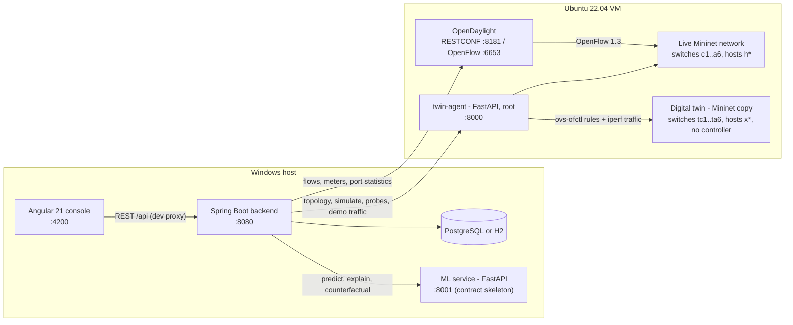
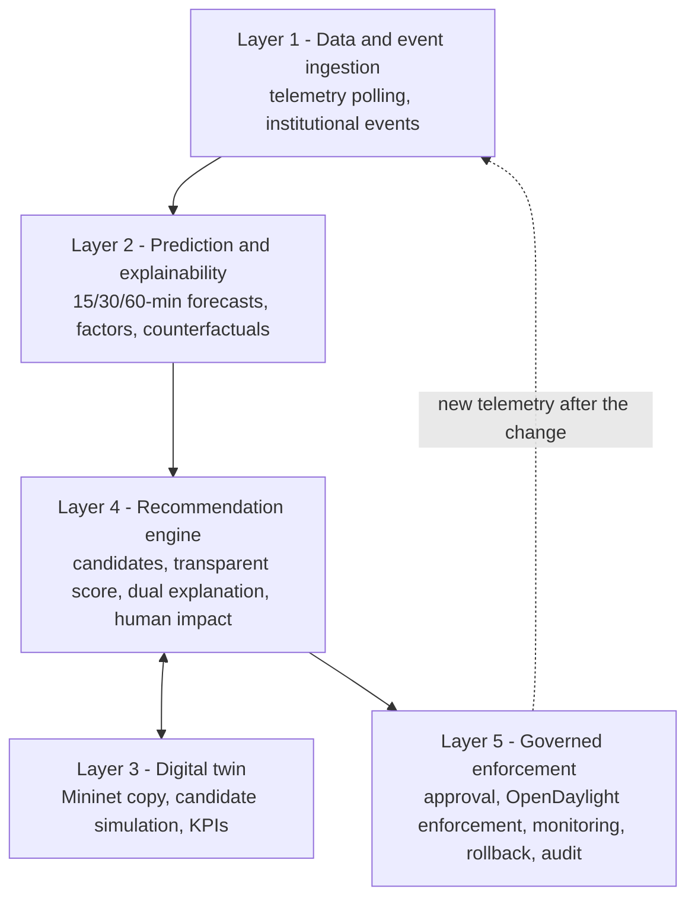
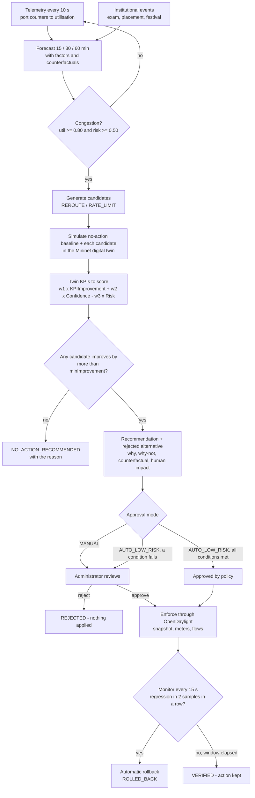
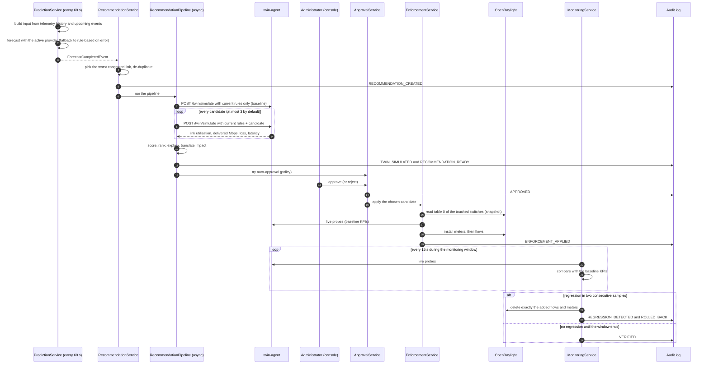
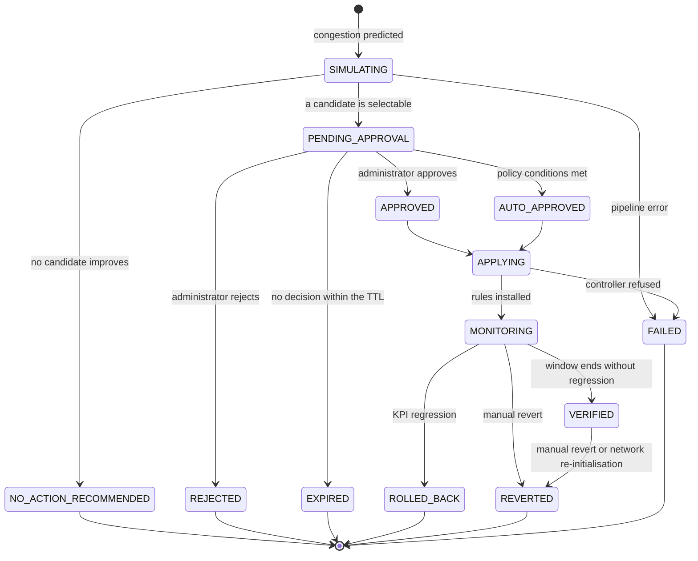
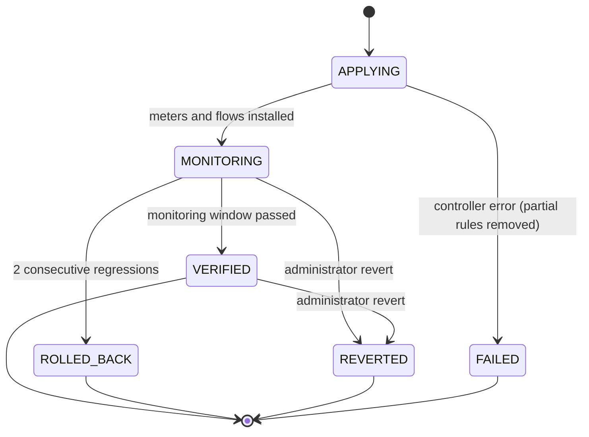
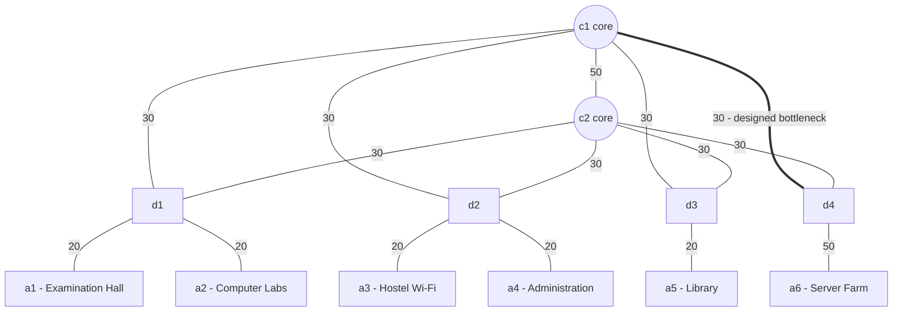
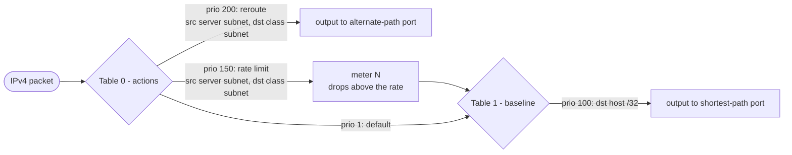
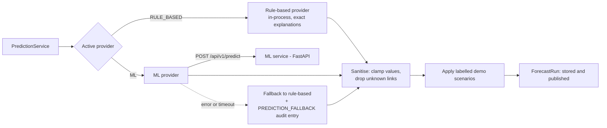

<a id="top"></a>

# EDGE-SDN

**An Event-Aware, Digital-Twin-Gated, Dual-Explainable Architecture for Autonomous Software-Defined Network Management**

*Final-year B.E. Computer Engineering project · academic prototype on an emulated campus network*

EDGE-SDN is a software layer that sits **above an SDN controller** (OpenDaylight). It watches network telemetry and the institution's calendar (examinations, placement drives, festivals) and predicts congestion 15–60 minutes ahead. It then works out candidate fixes and **tests every one of them in a Mininet digital twin** before recommending one. It explains both the prediction and the choice, and shows the impact on users in plain language. The administrator approves or rejects the recommendation (low-risk actions can be auto-approved by policy). The approved action is applied through the controller and watched afterwards; if the network gets worse, it is **rolled back automatically**. Every step is written to a **tamper-evident audit log**.

> **Where things stand:** the frontend and backend compile and run. The Mininet/OpenDaylight part needs an Ubuntu VM and has not been run yet. The ML model is not built yet: a transparent rule-based forecaster stands in for it behind the same interface. See [Current status](#status) for exactly what has and has not been verified.

---

<a id="toc"></a>

## Contents

| # | Section | What you will find |
|---|---|---|
| 1 | [The problem and the idea](#idea) | Why a layer above the controller, why a twin, why a human in the loop |
| 2 | [Architecture at a glance](#architecture) | Components, where they run, how they talk |
| 3 | [The five logical layers](#layers) | Each layer mapped to the code that implements it |
| 4 | [The closed loop, step by step](#loop) | Flowchart and sequence diagram of one congestion episode |
| 5 | [Inside each stage](#stages) | Telemetry, forecasting, candidates, twin, scoring, explanations, approval, enforcement, rollback, audit |
| 6 | [Lifecycles](#lifecycles) | State machines of recommendations, candidates and enforcements |
| 7 | [The emulated campus network](#campus) | Topology, host groups, the designed bottleneck |
| 8 | [How rules are installed (OpenFlow pipeline)](#pipeline) | Baseline routing, reroute and rate-limit rules |
| 9 | [ML integration](#ml) | Provider interface, ML service contract, safe fallback |
| 10 | [The administrator console](#console) | Every page of the Angular UI |
| 11 | [Security and roles](#security) | Who can do what |
| 12 | [Repository map](#repo) | Where every piece of code lives |
| 13 | [Getting started](#start) | The shortest path to a running system |
| 14 | [Demo walkthrough](#demo) | A 10-minute demonstration script |
| 15 | [Testing](#testing) | Unit, integration, E2E and UAT suites (Playwright) |
| 16 | [Configuration highlights](#config) | The knobs that matter |
| 17 | [Current status](#status) | Verified vs not yet verified |
| 18 | [Assumptions and limitations](#limits) | Stated plainly for the report and viva |
| 19 | [Viva FAQ](#faq) | Short answers to the questions examiners ask |
| 20 | [Glossary](#glossary) | Terms used in this project |

Installation and configuration are covered step by step in **[SETUP_GUIDE.md](SETUP_GUIDE.md)**. This README explains *what* the system does and *how* it works.

---

<a id="idea"></a>

## 1. The problem and the idea

Campus networks see predictable surges: an online examination, a placement drive's aptitude test, a festival live stream. Today these are handled reactively, once users already complain. SDN controllers can reprogram the network in seconds, but letting an AI push changes straight into production is risky.

EDGE-SDN combines three ideas:

| Idea | What it means here | Why it matters |
|---|---|---|
| **Event-aware prediction** | Forecasts combine recent telemetry with the institutional calendar | The exam is known in advance, so congestion can be predicted, not just detected |
| **Digital-twin gating** | Every candidate action is simulated in a Mininet copy of the network first, and only twin-validated improvements can be approved | Nothing untested reaches the live network |
| **Dual explainability** | (1) *Why is congestion predicted?* (factors and counterfactuals). (2) *Why this action and not the alternative?* (score breakdown, decision counterfactual, human-impact statement) | The administrator can trust, question and audit each decision |

The system is **not** "AI → automatic action". It is:

```text
Prediction → Candidate actions → Digital-twin validation → Recommendation → Explanation
          → Administrator review → Approval / rejection → Enforcement → Monitoring → (Rollback) → Audit
```

Auto-approval exists, but only for low-risk actions that meet every condition an administrator configured.

[↑ Back to top](#top)

---

<a id="architecture"></a>

## 2. Architecture at a glance



| Component | Technology | Responsibility | Code |
|---|---|---|---|
| Administrator console | Angular 21, standalone components, no UI libraries | Dashboard, review and approval, events, policy, audit, demo controls | [frontend/](frontend/) |
| Backend | Spring Boot 3.2, Java 17 target, JPA, Spring Security | All decision logic: ingestion, prediction orchestration, recommendation pipeline, approval, enforcement, monitoring, audit | [backend/](backend/) |
| Database | PostgreSQL (or file-based H2 for a quick run) | Telemetry, forecasts, events, recommendations, enforcements, policy, audit | [application.yml](backend/src/main/resources/application.yml) |
| SDN controller | OpenDaylight (OpenFlowPlugin + RFC 8040 RESTCONF) | Pushes the configured rules to the switches, reports port statistics | [OdlControllerClient.java](backend/src/main/java/com/edgesdn/sdn/OdlControllerClient.java) |
| twin-agent | Python, FastAPI, Mininet, Open vSwitch, iperf2 | Runs the live emulated network and the digital twin, and measures KPIs | [twin-agent/](twin-agent/) |
| ML service | Python, FastAPI (placeholder model today) | Future LSTM forecaster with SHAP/LIME explanations, behind a fixed REST contract | [ml-service/](ml-service/) |

**Design choices that keep the prototype honest and replaceable:**

- The backend only talks to the controller through the [`SdnControllerClient`](backend/src/main/java/com/edgesdn/sdn/SdnControllerClient.java) interface, so ONOS or Ryu could replace OpenDaylight by writing one class.
- Forecasting sits behind the [`PredictionProvider`](backend/src/main/java/com/edgesdn/prediction/PredictionProvider.java) interface, so the rule-based forecaster and the ML service can be swapped at runtime.
- The twin receives **the same rule set** as the live network. It is translated to `ovs-ofctl` syntax instead of RESTCONF JSON, so it validates what would really be installed.

[↑ Back to top](#top)

---

<a id="layers"></a>

## 3. The five logical layers



| Layer | Main classes | What it produces |
|---|---|---|
| **1 · Ingestion** | [TelemetryService](backend/src/main/java/com/edgesdn/telemetry/TelemetryService.java), [EventService](backend/src/main/java/com/edgesdn/event/EventService.java), [TopologyService](backend/src/main/java/com/edgesdn/topology/TopologyService.java) | Link utilisation every 10 s, per-group demand, the event calendar, the topology |
| **2 · Prediction** | [PredictionService](backend/src/main/java/com/edgesdn/prediction/PredictionService.java), [RuleBasedPredictionProvider](backend/src/main/java/com/edgesdn/prediction/RuleBasedPredictionProvider.java), [MlPredictionProvider](backend/src/main/java/com/edgesdn/ml/MlPredictionProvider.java), [ScenarioService](backend/src/main/java/com/edgesdn/prediction/ScenarioService.java) | Forecast per link and horizon with range, risk, confidence, factors and counterfactuals |
| **3 · Digital twin** | [TwinService](backend/src/main/java/com/edgesdn/twin/TwinService.java), [TrafficProfileBuilder](backend/src/main/java/com/edgesdn/twin/TrafficProfileBuilder.java), [KpiCalculator](backend/src/main/java/com/edgesdn/twin/KpiCalculator.java), agent [network.py](twin-agent/agent/network.py) and [traffic.py](twin-agent/agent/traffic.py) | Measured KPIs for "no action" and for every candidate under the predicted load |
| **4 · Recommendation** | [RecommendationPipeline](backend/src/main/java/com/edgesdn/recommendation/RecommendationPipeline.java), [CandidateGenerator](backend/src/main/java/com/edgesdn/recommendation/CandidateGenerator.java), [ScoringService](backend/src/main/java/com/edgesdn/recommendation/ScoringService.java), [ExplanationService](backend/src/main/java/com/edgesdn/recommendation/ExplanationService.java), [HumanImpactTranslator](backend/src/main/java/com/edgesdn/recommendation/HumanImpactTranslator.java) | A ranked, explained recommendation with the rejected alternative |
| **5 · Governance** | [ApprovalService](backend/src/main/java/com/edgesdn/recommendation/ApprovalService.java), [EnforcementService](backend/src/main/java/com/edgesdn/enforcement/EnforcementService.java), [MonitoringService](backend/src/main/java/com/edgesdn/enforcement/MonitoringService.java), [AuditService](backend/src/main/java/com/edgesdn/audit/AuditService.java), [PolicyService](backend/src/main/java/com/edgesdn/policy/PolicyService.java) | Applied, monitored, verified or rolled-back actions and a hash-chained audit trail |

[↑ Back to top](#top)

---

<a id="loop"></a>

## 4. The closed loop, step by step

### 4.1 Decision flow



Every box above writes at least one entry to the audit log (see [5.10](#s-audit)).

### 4.2 One congestion episode as a sequence



**Safeguards on the loop:**

- Only **one** twin simulation runs at a time.
- Only **one** open recommendation per link.
- No new decision is started while an action is being applied or monitored.
- Each traffic class can have only one active action.

[↑ Back to top](#top)

---

<a id="stages"></a>

## 5. Inside each stage

Open any stage to see exactly how it works.

<a id="s-telemetry"></a>
<details>
<summary><b>5.1 Telemetry ingestion (Layer 1)</b></summary>

- Every **10 s** the backend reads byte counters, either from OpenDaylight port statistics (default) or from the agent's interface counters (`edge.telemetry.source: AGENT`).
- For each link it uses the transmitted bytes of **both** ends and takes the busier direction:

  ```text
  utilisation(link) = max(Δtx_A, Δtx_B) × 8 / Δt / capacity_Mbps
  ```
- Demand per host group is the traffic delivered to that group's hosts (the transmitted bytes of the host ports).
- A counter that goes backwards (switch restart) is ignored for that sample.
- Samples are kept **48 h**, and an hourly clean-up deletes older ones.
- Code: [TelemetryService.java](backend/src/main/java/com/edgesdn/telemetry/TelemetryService.java).

</details>

<a id="s-events"></a>
<details>
<summary><b>5.2 Institutional events (Layer 1)</b></summary>

An event has a name, a type (`EXAM`, `PLACEMENT`, `FESTIVAL`, `OTHER`), a start time, a duration, an expected intensity (0–1) and the affected host groups. An empty group list means all client groups.

```json
{ "name": "Semester Examination", "type": "EXAM", "startTime": "2026-10-05T04:30:00Z",
  "durationMinutes": 180, "expectedIntensity": 0.85, "affectedGroups": ["EXAM_HALL"] }
```

- Events are created in the UI or imported from CSV (`name,type,startTime,durationMinutes,expectedIntensity,affectedGroups,description`, groups separated by `;`). Invalid lines are reported with line numbers.
- Three **synthetic, clearly labelled** sample events are created on an empty database.
- Code: [EventService.java](backend/src/main/java/com/edgesdn/event/EventService.java).

</details>

<a id="s-forecast"></a>
<details>
<summary><b>5.3 Forecasting and the prediction explanation (Layer 2)</b></summary>

Every **60 s** (and on demand) the backend builds the input: 30 minutes of history per link, the groups using each link, and the events around the forecast horizon. It then calls the active provider. Until the ML model exists, the **rule-based provider** does the forecasting:

```text
predicted(h) = EWMA(recent utilisation, α = 0.3)
             + clamp(trend per minute × h, −0.3, +0.3)
             + Σ over events active at now+h:  intensity × typeFactor × activity × affectedShare

typeFactor     EXAM 0.7 · PLACEMENT 0.6 · FESTIVAL 0.8 · OTHER 0.4
activity       1 during the event, rising 0 → 1 over the 10 minutes before it starts
affectedShare  affected groups on the link ÷ groups using the link
risk           sigmoid((predicted − 0.80) / 0.04)
confidence     clamp(min(1, samples/12) × (1 − min(0.6, uncertainty)), 0.2, 0.95)
```

**Worked example** (illustrative numbers) for link `c1-d4`, horizon 30 min, exam starting in 20 min:

| Term | Value | Contribution |
|---|---|---|
| recent baseline (EWMA) | 72 % | +72 pp |
| trend | +0.1 pp/min | +3 pp |
| event "Semester Examination" | 0.85 × 0.7 × 1.0 × (1 of 5 groups) | +12 pp |
| **predicted** | | **87 %** → risk 0.85 → **congestion** |

Because the model is additive, its explanations are exact, not approximated:

- **Factual:** the table above, shown in the UI as factor rows.
- **Counterfactual:** "Without event 'Semester Examination' the prediction would be 75 % (below the 80 % threshold)".

Forecasts for 15, 30 and 60 minutes are stored with their range, risk, confidence, factors and counterfactuals. Congestion means **predicted ≥ 80 % and risk ≥ 0.5** (both configurable).

**Demo scenarios.** An administrator can inject a forecast override (for example 95 % on `c1-d4`) to reproduce a congestion episode on demand. It is labelled everywhere: the source becomes `RULE_BASED+SCENARIO`, the first factor is `scenario-override` ("DEMO SCENARIO injected by …"), and the audit log records it.

Code: [PredictionService.java](backend/src/main/java/com/edgesdn/prediction/PredictionService.java), [RuleBasedPredictionProvider.java](backend/src/main/java/com/edgesdn/prediction/RuleBasedPredictionProvider.java), [ScenarioService.java](backend/src/main/java/com/edgesdn/prediction/ScenarioService.java).

</details>

<a id="s-candidates"></a>
<details>
<summary><b>5.4 Candidate actions (Layer 4)</b></summary>

For the congested link, each **traffic class** is considered. A class is the downloads from the server farm to one client group whose current path crosses the link. Two kinds of candidate are generated:

| Action | When | What is installed |
|---|---|---|
| **REROUTE** | an alternate path avoiding the link exists | priority-200 rules on the switches of the alternate path |
| **RATE_LIMIT** | the class is not HIGH priority | an OpenFlow drop meter at the server access switch, set to 60 % of the predicted demand (`rateLimitFraction`) |

- Classes that already have an active action are skipped.
- Candidates are interleaved, highest demand first, up to `maxCandidates` (3).
- No action ever disables a switch or a link.
- Code: [CandidateGenerator.java](backend/src/main/java/com/edgesdn/recommendation/CandidateGenerator.java), [RoutingService.java](backend/src/main/java/com/edgesdn/routing/RoutingService.java).

</details>

<a id="s-twin"></a>
<details>
<summary><b>5.5 Digital-twin validation (Layer 3)</b></summary>

1. **Predicted load.** Classes crossing the congested link are scaled so their total equals the forecast load of that link (for example 95 % × 30 Mbps = 28.5 Mbps). Other classes keep their measured demand, with at least 1 Mbps each.
2. **Same rules as live.** The twin gets the complete rule set: baseline routing, plus the currently active actions, plus the candidate. It is loaded with `ovs-ofctl`. The twin has **no controller**, so nothing can leak into the live network.
3. **Replay.** One iperf2 UDP stream is started per destination host, each on its own port so each stream is reported separately. Ping probes run per class under load.
4. **Measure** over the steady-state window (8 s run):
   - per-link utilisation from interface counters;
   - delivered Mbps and loss per stream;
   - average latency per class.
5. A **no-action baseline** run is always made first, and each candidate is compared against it under identical traffic.

A candidate the twin could not simulate is `SIMULATION_FAILED` and **can never be approved**.

Code: [TwinService.java](backend/src/main/java/com/edgesdn/twin/TwinService.java), [KpiCalculator.java](backend/src/main/java/com/edgesdn/twin/KpiCalculator.java), [twin-agent/agent/traffic.py](twin-agent/agent/traffic.py).

</details>

<a id="s-score"></a>
<details>
<summary><b>5.6 Transparent scoring (Layer 4)</b></summary>

```text
Score = w1 × KPIImprovement + w2 × Confidence − w3 × Risk        (defaults w1 0.5 · w2 0.2 · w3 0.3)
```

| Term | Definition | Sub-weights |
|---|---|---|
| **KPIImprovement** | Weighted mean of the relative gains vs the no-action twin run, clamped to 0–1: target-link utilisation, busiest-link utilisation, latency and loss of the *protected* traffic | 0.35 / 0.25 / 0.25 / 0.15 |
| **Risk** | Weighted mean, 0–1, of: **disruption** (share of demand whose treatment changes), **path stretch** (extra hops), **core touch** (share of rules on core switches), **loss spike** (new loss in the twin), **priority impact** (throughput cut on a HIGH/MEDIUM/LOW class, or a path change) | 0.30 / 0.20 / 0.15 / 0.15 / 0.20 |
| **Confidence** | Confidence of the prediction that triggered the recommendation | — |

- "Protected" traffic excludes the class a rate-limit deliberately slows down. That slowdown is counted as risk, not as a KPI loss.
- A candidate is **selectable** only if its raw improvement exceeds `minImprovement` (0.05).
- Candidates are ranked by score, with lower risk breaking ties.

**Worked example** (illustrative numbers):

| Candidate | KPIImprovement | Confidence | Risk | Score |
|---|---|---|---|---|
| Reroute Server Farm → Examination Hall via `a6 > d4 > c2 > d1 > a1` | 0.72 | 0.82 | 0.187 | 0.5×0.72 + 0.2×0.82 − 0.3×0.187 = **0.468** ✅ selected |
| Rate-limit Server Farm → Hostel Wi-Fi to 6 Mbps | 0.58 | 0.82 | 0.410 | 0.5×0.58 + 0.2×0.82 − 0.3×0.410 = **0.331** alternative |

Code: [ScoringService.java](backend/src/main/java/com/edgesdn/recommendation/ScoringService.java).

</details>

<a id="s-explain"></a>
<details>
<summary><b>5.7 The second explanation: why this action, why not the other, and what users will notice</b></summary>

All texts are generated from stored numbers, so they can be checked against the data ([ExplanationService.java](backend/src/main/java/com/edgesdn/recommendation/ExplanationService.java), [HumanImpactTranslator.java](backend/src/main/java/com/edgesdn/recommendation/HumanImpactTranslator.java)). With the example above:

- **Why this action:** *"Selected: Reroute Server Farm -> Examination Hall traffic via a6 > d4 > c2 > d1 > a1. Score 0.468 = 0.50 x KPIImprovement 0.720 + 0.20 x Confidence 0.820 - 0.30 x Risk 0.187. Digital twin: target link 98% -> 61%, …"*
- **Why not the alternative:** the dominant difference, either weighted KPI improvement or weighted risk (naming the largest risk factor). If the alternative was not eligible, the reason is given ("could not be simulated", "no improvement above 0.05").
- **Decision counterfactual (bounded to 0–1):** the smallest change that would have flipped the choice. Here: *"Even with zero risk the alternative would not have been selected. If its KPI improvement were above 0.854 (it is 0.580), it would have been selected."*
- **Human impact:** *"Without action, link c1-d4 is expected to be about 87% loaded in ~30 minutes, mainly because of the event 'Semester Examination'. Downloads from the Server Farm to Examination Hall (~300 users) will take the alternate path a6 > d4 > c2 > d1 > a1. … Users who benefit: about 1 260."*

</details>

<a id="s-approval"></a>
<details>
<summary><b>5.8 Approval: the administrator's role (Layer 5)</b></summary>

| Mode | Behaviour |
|---|---|
| `MANUAL` (default) | The recommendation waits as `PENDING_APPROVAL` for **15 minutes** (then `EXPIRED`). The administrator can approve it, approve the alternative instead, or reject it with a reason. |
| `AUTO_LOW_RISK` | Approved **by policy** only if **all** hold: risk ≤ 0.25, score ≥ 0.35, confidence ≥ 0.60, the action type is allowed (default `REROUTE` only), and fewer than 3 auto-approvals in the last hour. Otherwise it waits for the administrator, with a note saying which condition failed. |

Approval is refused if:

- the candidate was not validated as an improvement;
- another action is being applied or monitored;
- the traffic class already has an active action.

Code: [ApprovalService.java](backend/src/main/java/com/edgesdn/recommendation/ApprovalService.java).

</details>

<a id="s-enforce"></a>
<details>
<summary><b>5.9 Enforcement, monitoring and automatic rollback (Layer 5)</b></summary>

**Enforcement** ([EnforcementService.java](backend/src/main/java/com/edgesdn/enforcement/EnforcementService.java)):

1. Snapshot of the configured table 0 of every touched switch (from OpenDaylight).
2. Baseline live KPIs: link utilisation plus ping probes.
3. Install the meters first, then the flows, in OpenDaylight's config datastore (RESTCONF).
4. If anything fails, everything already installed is removed and the result is `FAILED`.

**Monitoring** ([MonitoringService.java](backend/src/main/java/com/edgesdn/enforcement/MonitoringService.java)) runs every **15 s** for 180 s. A sample is a **regression** if any of these holds:

| KPI | Rule |
|---|---|
| Busiest-link utilisation | more than 15 % above baseline **and** at least 5 pp higher |
| Average latency | more than 50 % above baseline **and** at least 5 ms higher |
| Probe loss | above 5 % **and** at least 1 pp above baseline |

- **Two regressions in a row** trigger an automatic rollback. It deletes exactly the rules and meters of that action, and the baseline routing takes over again.
- Otherwise the action becomes **VERIFIED** and stays.
- The administrator can revert an action at any time.
- For demonstrations, an administrator can *inject* a regression. It is labelled `DEMO` in the reason and in the audit log, and never shown as measured data.

</details>

<a id="s-audit"></a>
<details>
<summary><b>5.10 Tamper-evident audit log</b></summary>

- Every step writes an entry with the actor: the user, `SYSTEM`, `SYSTEM:twin`, `SYSTEM:monitor` or `SYSTEM:auto-policy`.
- Each entry stores `hash = SHA-256(prevHash | time | actor | type | ids | summary | details)`, so changing any past entry breaks the chain.
- `GET /api/audit/verify` (the **Verify hash chain** button) recomputes the whole chain.
- Entry types include `RECOMMENDATION_CREATED`, `TWIN_SIMULATED`, `RECOMMENDATION_READY`, `APPROVED`, `AUTO_APPROVED`, `REJECTED`, `ENFORCEMENT_APPLIED`, `REGRESSION_DETECTED`, `ROLLED_BACK`, `VERIFIED`, `POLICY_UPDATED`, `PREDICTION_FALLBACK`, `SCENARIO_INJECTED` and more.
- Code: [AuditService.java](backend/src/main/java/com/edgesdn/audit/AuditService.java).

</details>

[↑ Back to top](#top)

---

<a id="lifecycles"></a>

## 6. Lifecycles

### Recommendation



### Candidate

| Status | Meaning | Can be approved? |
|---|---|---|
| `SELECTABLE` | Simulated, and it improves KPIs by more than `minImprovement` | ✅ |
| `NO_GAIN` | Simulated, but no meaningful improvement (or a regression) | ❌ |
| `SIMULATION_FAILED` | The twin could not simulate it | ❌ never |

### Enforcement



After a backend restart, work that was interrupted mid-way (`SIMULATING`, `APPLYING`) is marked `FAILED` rather than silently resumed.

[↑ Back to top](#top)

---

<a id="campus"></a>

## 7. The emulated campus network

It is defined once in [twin-agent/agent/topology.py](twin-agent/agent/topology.py) and served to the backend, so names, ports and addresses always match. It has 12 switches, 15 links and 16 hosts.



*Link labels are capacities in Mbps.*

| Group | Access switch | Subnet | Hosts | Priority | Users represented |
|---|---|---|---|---|---|
| EXAM_HALL | a1 | 10.0.1.0/24 | 4 | HIGH | 300 |
| LAB | a2 | 10.0.2.0/24 | 3 | MEDIUM | 180 |
| HOSTEL | a3 | 10.0.3.0/24 | 3 | LOW | 600 |
| ADMIN | a4 | 10.0.4.0/24 | 2 | HIGH | 60 |
| LIBRARY | a5 | 10.0.5.0/24 | 2 | MEDIUM | 120 |
| SERVERS | a6 | 10.0.10.0/24 | 2 | — | — |

**Why `c1-d4` congests.** Baseline routing uses deterministic shortest paths (BFS, neighbours in name order), so **every** download from the server farm goes `a6 → d4 → c1 → …`. The demo load (12 + 6 + 10 + 2 + 3 = 33 Mbps) exceeds that link's 30 Mbps. The path through **c2** is equally short, which is what REROUTE candidates use.

[↑ Back to top](#top)

---

<a id="pipeline"></a>

## 8. How rules are installed (OpenFlow pipeline)



- **Baseline** (programmed at start-up or with *(Re)initialise baseline routing*) has 16 hosts × 12 switches = 192 `/32` rules plus 12 default rules. Hosts use **static ARP**, so nothing is flooded in the looped topology.
- **Actions only add rules** above the baseline. Rollback is therefore simply "delete exactly those rules and meters".
- The same `FlowSpec` is written to OpenDaylight as RESTCONF JSON (live) and to the twin as `ovs-ofctl` text ([ovs.py](twin-agent/agent/ovs.py)).

[↑ Back to top](#top)

---

<a id="ml"></a>

## 9. ML integration



| ML service endpoint | Used for |
|---|---|
| `GET /api/v1/health` | status in the console |
| `GET /api/v1/model-info` | model version, and whether it is a trained model (the placeholder says it is not) |
| `POST /api/v1/predict` | forecasts + factual explanation (e.g. SHAP) + counterfactuals, one per link × horizon |
| `POST /api/v1/explain` | detailed SHAP/LIME explanation for one link and horizon |
| `POST /api/v1/counterfactual` | bounded counterfactual search towards a target utilisation |

- The request is the same `PredictionInput` the rule-based provider receives. The full JSON contract is in [SETUP_GUIDE.md §14](SETUP_GUIDE.md).
- The provider is switched at runtime on the Predictions page or with `PUT /api/ml/provider`.
- Training data is exported from `/api/ml/training-data/telemetry.csv` and `events.csv`.
- **Today** the service returns a *persistence placeholder* (last observed value, confidence 0.3) labelled as such. The LSTM forecaster and SHAP/LIME explainers go into [ml-service/app/model.py](ml-service/app/model.py) without changing the contract.

[↑ Back to top](#top)

---

<a id="console"></a>

## 10. The administrator console

| Page | What the administrator does there | Code |
|---|---|---|
| **Dashboard** | Live topology coloured by utilisation (green < 50 %, amber < 80 %, red ≥ 80 %); links predicted to congest are dashed; open decisions; active actions; approval mode | [dashboard.component.ts](frontend/src/app/pages/dashboard.component.ts) |
| **Recommendations** | List with status filter; *Evaluate network now* | [recommendations.component.ts](frontend/src/app/pages/recommendations.component.ts) |
| **Recommendation detail** | (1) why action is needed, (2) human impact, (3) recommended vs alternative with scores, twin KPIs, why / why-not / counterfactual, (4) **approve, approve alternative or reject**; all candidates; audit trail | [recommendation-detail.component.ts](frontend/src/app/pages/recommendation-detail.component.ts) |
| **Enforcements** | Applied actions, baseline vs latest KPIs, **revert**, demo regression injection | [enforcements.component.ts](frontend/src/app/pages/enforcements.component.ts) |
| **Predictions** | Latest forecasts with factors and counterfactuals; switch between rule-based and ML; fallback warnings | [predictions.component.ts](frontend/src/app/pages/predictions.component.ts) |
| **Telemetry** | Current link utilisation, 30-minute history chart, group demand | [telemetry.component.ts](frontend/src/app/pages/telemetry.component.ts) |
| **Institutional events** | Create, edit, delete, CSV import | [events.component.ts](frontend/src/app/pages/events.component.ts) |
| **Policy** | Approval mode, score weights, thresholds, rollback limits | [policy.component.ts](frontend/src/app/pages/policy.component.ts) |
| **Audit log** | Filter, inspect entries, **verify the hash chain** | [audit.component.ts](frontend/src/app/pages/audit.component.ts) |
| **Network & demo** | Controller and agent status, re-initialise baseline routing, start real demo load, inject labelled forecast scenarios | [control.component.ts](frontend/src/app/pages/control.component.ts) |

[↑ Back to top](#top)

---

<a id="security"></a>

## 11. Security and roles

| Role | Default login | Can |
|---|---|---|
| `ADMIN` | `admin` / `admin123` | everything: approve, reject, revert, policy, events, demo controls |
| `VIEWER` | `viewer` / `viewer123` | read every page, including explanations and the audit log; cannot change anything (the backend returns 403) |

- HTTP Basic, stateless.
- 401 responses carry no browser login prompt.
- CORS is limited to the console's origin.
- The twin-agent requires a shared token (`X-Edge-Token`).
- Change the default passwords in `application.yml`. This is prototype-level security (see [limitations](#limits)).

[↑ Back to top](#top)

---

<a id="repo"></a>

## 12. Repository map

<details open>
<summary><b>Folders and key files</b></summary>

| Path | Contents |
|---|---|
| [SETUP_GUIDE.md](SETUP_GUIDE.md) | Step-by-step installation, configuration, API reference, ML contract, troubleshooting |
| [backend/](backend/) | Spring Boot backend ([pom.xml](backend/pom.xml), [application.yml](backend/src/main/resources/application.yml)) |
| ├ [config/](backend/src/main/java/com/edgesdn/config/) | settings, REST clients, security |
| ├ [topology/](backend/src/main/java/com/edgesdn/topology/) · [routing/](backend/src/main/java/com/edgesdn/routing/) | topology index with deterministic paths; OpenFlow rule builder |
| ├ [telemetry/](backend/src/main/java/com/edgesdn/telemetry/) · [event/](backend/src/main/java/com/edgesdn/event/) | Layer 1 |
| ├ [prediction/](backend/src/main/java/com/edgesdn/prediction/) · [ml/](backend/src/main/java/com/edgesdn/ml/) | Layer 2 and ML integration |
| ├ [twin/](backend/src/main/java/com/edgesdn/twin/) · [agent/](backend/src/main/java/com/edgesdn/agent/) | Layer 3 (digital-twin gate, agent client) |
| ├ [recommendation/](backend/src/main/java/com/edgesdn/recommendation/) | Layer 4 + approval |
| ├ [enforcement/](backend/src/main/java/com/edgesdn/enforcement/) · [sdn/](backend/src/main/java/com/edgesdn/sdn/) · [network/](backend/src/main/java/com/edgesdn/network/) | Layer 5: enforcement, monitoring, controller client, baseline initialisation |
| └ [policy/](backend/src/main/java/com/edgesdn/policy/) · [audit/](backend/src/main/java/com/edgesdn/audit/) · [system/](backend/src/main/java/com/edgesdn/system/) | policy, audit chain, dashboard/health/seed data |
| [twin-agent/](twin-agent/) | Mininet + FastAPI agent ([main.py](twin-agent/agent/main.py), [topology.py](twin-agent/agent/topology.py), [network.py](twin-agent/agent/network.py), [traffic.py](twin-agent/agent/traffic.py), [ovs.py](twin-agent/agent/ovs.py)) |
| [ml-service/](ml-service/) | ML contract skeleton ([main.py](ml-service/app/main.py), [schemas.py](ml-service/app/schemas.py), [model.py](ml-service/app/model.py)) |
| [frontend/](frontend/) | Angular console ([pages/](frontend/src/app/pages/), [core/](frontend/src/app/core/), [shared/](frontend/src/app/shared/)) |
| [tests/](tests/) | Playwright suites ([playwright.config.ts](tests/playwright.config.ts), [unit/](tests/unit/), [integration/](tests/integration/), [e2e/](tests/e2e/), [uat/](tests/uat/)) |

</details>

[↑ Back to top](#top)

---

<a id="start"></a>

## 13. Getting started

<details open>
<summary><b>Run the console and backend on Windows (no network emulation)</b></summary>

```powershell
# backend (JDK 17+ and Maven 3.9; H2 profile = no PostgreSQL needed)
cd edge-sdn\backend
mvn -DskipTests package
java -jar target\edge-sdn-backend-1.0.0.jar --spring.profiles.active=h2

# console (Node 20.19+ / 22 / 24)
cd ..\frontend
npm install
npm start          # http://localhost:4200  ->  admin / admin123
```

Without the VM the console works for events, policy, audit and status. The dashboard says, correctly, that the topology is not loaded.

</details>

<details>
<summary><b>Full closed loop (Ubuntu VM with Mininet and OpenDaylight)</b></summary>

1. Create the VM (host-only IP `192.168.56.101`) and install Mininet, Open vSwitch and iperf: [SETUP_GUIDE §3–4](SETUP_GUIDE.md).
2. Install OpenDaylight and the OpenFlowPlugin REST feature: [§5](SETUP_GUIDE.md).
3. Start the twin-agent as root: `sudo ./run_agent.sh` ([§6](SETUP_GUIDE.md)).
4. Point `edge.agent.base-url` and `edge.odl.base-url` at the VM, then start the backend and the console.
5. Check: the dashboard shows the topology, and the audit log has `TOPOLOGY_LOADED` and `NETWORK_INITIALIZED`.

</details>

[↑ Back to top](#top)

---

<a id="demo"></a>

## 14. Demo walkthrough

A 10-minute script for a review or viva. It needs the full stack.

- [ ] **Network & demo → Exam-surge preset → Start traffic.** Real UDP load of 33 Mbps goes over the 30 Mbps link `c1-d4`, and the dashboard turns it red.
- [ ] **Institutional events:** show the (synthetic) semester examination, or add one starting in 5 minutes.
- [ ] **Predictions → Run forecast now.** `c1-d4` is predicted at 80 % or more; click the row to show the factors and the counterfactual. *(If the load is too light, use a labelled forecast override on the Network & demo page.)*
- [ ] **Recommendations:** the new recommendation goes `SIMULATING` → `PENDING_APPROVAL` after about 40–50 s of twin runs (baseline + up to 3 candidates, about 10 s each).
- [ ] **Open it** and walk through sections 1–4: the prediction, the human impact, recommended vs alternative, the score equation, why-not, the counterfactual and the twin KPIs.
- [ ] **Approve.** It goes `APPROVED → APPLYING → MONITORING`. Rules appear in `ovs-ofctl dump-flows`, and the load on `c1-d4` drops.
- [ ] **Enforcements → Inject regression (demo).** After about 30 s it is automatically `ROLLED_BACK`, with the reason labelled DEMO.
- [ ] **Policy → AUTO_LOW_RISK.** Repeat, and a low-risk reroute is approved by `SYSTEM:auto-policy`, or the note explains which condition failed.
- [ ] **Audit log → Verify hash chain:** "Audit chain intact".

[↑ Back to top](#top)

---

<a id="testing"></a>

## 15. Testing

Playwright suites in [tests/](tests/) (a separate npm project):

| Level | Approx. tests | Focus | Needs |
|---|---|---|---|
| Unit | ~100 | Frontend logic: formatting, validation, policy coercion, layout and chart maths, session storage | nothing |
| Integration | ~150 | REST contracts of the backend, twin-agent and ML service; roles, validation, audit chain, CORS | backend (+ agent / ML) |
| E2E (mocked) | 46 | The real UI with a stateful in-browser fake backend: review and approval flows, dashboard, rollback demo | dev server only |
| E2E (live) | 29 | Real UI + backend: login, roles, events, policy, audit, navigation | dev server + backend |
| UAT | 10 | Given/When/Then acceptance: governance (UAT-01…05), closed loop on Mininet (UAT-06…09), ML fallback (UAT-10) | full stack for UAT-06…10 |

```powershell
cd edge-sdn\tests
npm install; npx playwright install chromium
npm run test:unit        # test:integration · test:e2e:mocked · test:e2e:live · test:uat · report
```

- Suites that need the VM **skip themselves** when it is absent (set `EDGE_REQUIRE_NETWORK=1` to make them fail instead).
- Test data is prefixed `PW-TEST` and cleaned up.
- The suites are written but **not yet executed**. Details: [SETUP_GUIDE §16](SETUP_GUIDE.md).

[↑ Back to top](#top)

---

<a id="config"></a>

## 16. Configuration highlights

<details>
<summary><b>Decision policy (database-backed, edited on the Policy page)</b></summary>

| Parameter | Default | Meaning |
|---|---|---|
| `approvalMode` | `MANUAL` | or `AUTO_LOW_RISK` |
| `weightImprovement` / `weightConfidence` / `weightRisk` | 0.5 / 0.2 / 0.3 | score weights w1 / w2 / w3 |
| `congestionUtilThreshold` / `congestionRiskThreshold` | 0.80 / 0.50 | when action is required |
| `minImprovement` | 0.05 | minimum raw KPI gain to be selectable |
| `maxCandidates` / `rateLimitFraction` | 3 / 0.60 | candidate generation |
| `autoMaxRisk` / `autoMinScore` / `autoMinConfidence` | 0.25 / 0.35 / 0.60 | auto-approval conditions |
| `autoAllowedActions` / `autoMaxPerHour` | `REROUTE` / 3 | auto-approval limits |
| `recommendationTtlMinutes` | 15 | pending recommendations expire |
| `monitorWindowSec` | 180 | post-enforcement watch |
| `rollbackUtilIncreasePct` / `rollbackLatencyIncreasePct` / `rollbackLossPct` | 15 / 50 / 5 | regression limits |

</details>

<details>
<summary><b>Deployment settings (<code>application.yml</code>, <code>edge.*</code>)</b></summary>

| Key | Default | Meaning |
|---|---|---|
| `edge.agent.base-url` / `token` | `http://192.168.56.101:8000` | twin-agent |
| `edge.odl.base-url` / `data-path` | `http://192.168.56.101:8181` / `/rests/data` | OpenDaylight RESTCONF |
| `edge.telemetry.source` / `poll-interval-ms` | `ODL` / 10000 | telemetry source and period |
| `edge.prediction.provider` / `interval-ms` / `horizons-minutes` | `RULE_BASED` / 60000 / 15, 30, 60 | forecasting |
| `edge.ml.base-url` / `fallback-to-rule-based` | `http://localhost:8001` / true | ML service |
| `edge.twin.duration-sec` | 8 | replay time per twin run |
| `edge.monitoring.sample-interval-ms` / `consecutive-regressions` | 15000 / 2 | rollback monitor |

The full reference is in [SETUP_GUIDE §8](SETUP_GUIDE.md).

</details>

[↑ Back to top](#top)

---

<a id="status"></a>

## 17. Current status

| Part | State |
|---|---|
| Angular console | ✅ installed, compiled without errors or warnings, served (Node 24.11, Angular 21.2) |
| Spring Boot backend | ✅ compiled (JDK 23.0.1, Maven 3.9) and started with the H2 profile; REST API responds; security, validation and error format checked by hand |
| twin-agent (Mininet) | ⏳ written; needs the Ubuntu VM, not run yet |
| OpenDaylight integration | ⏳ written against RFC 8040 RESTCONF; not exercised yet |
| ML service | ⏳ contract skeleton with a labelled placeholder model; not run yet |
| LSTM + SHAP/LIME | ❌ not implemented yet (planned behind the existing contract) |
| Playwright suites | ⏳ written and type-checked; not executed (Playwright not installed yet) |

[↑ Back to top](#top)

---

<a id="limits"></a>

## 18. Assumptions and limitations

1. **Requirements source.** The SRS and synopsis were not available when this was built; the project brief was used. Where it was ambiguous, the simplest option was chosen:
   - traffic classes are downloads from the server farm to client groups;
   - the actions are REROUTE and RATE_LIMIT;
   - there is one congested link per recommendation;
   - one action is applied or monitored at a time.
2. **No ML yet.** The rule-based forecaster is transparent but simple.
3. **Emulated network only:** a Mininet campus with small capacities (20–50 Mbps) that a laptop can saturate. No physical hardware.
4. **The twin is a structural copy** that replays predicted demand as UDP; it does not model TCP dynamics or application behaviour.
5. **OpenDaylight only**, behind a replaceable interface; only the RFC 8040 RESTCONF format is supported.
6. **Prototype security:** HTTP Basic, two in-memory users, a shared agent token, plain HTTP.
7. **Demo aids** (forecast overrides, generated load, injected regressions) are always labelled and never presented as measured data.
8. **Rollback** removes exactly what EDGE-SDN added; it cannot undo changes made outside EDGE-SDN.

[↑ Back to top](#top)

---

<a id="faq"></a>

## 19. Viva FAQ

<details>
<summary><b>Why sit above the controller instead of modifying it?</b></summary>

Controllers are good at *installing* rules; they do not know about exams or placement drives, and they do not explain decisions. A layer above keeps the controller unchanged and replaceable (`SdnControllerClient`), and puts prediction, validation and governance where they can be audited.

</details>

<details>
<summary><b>Why a digital twin? Why not just apply the best-looking action?</b></summary>

A forecast can be wrong and an action can have side effects, such as moving congestion elsewhere. The twin measures each candidate under the predicted load with the *real* rule set before anything touches the live network. Candidates that fail or do not improve cannot be approved at all.

</details>

<details>
<summary><b>How exactly is the recommendation chosen?</b></summary>

`Score = w1·KPIImprovement + w2·Confidence − w3·Risk`. Every term is 0–1, and every sub-term and weight is shown in the UI and stored with the recommendation. See [5.6](#s-score). Nothing is a black box: the console shows the equation with its numbers.

</details>

<details>
<summary><b>What does "dual explainability" mean here?</b></summary>

(1) The **prediction** is explained: factors and counterfactuals ("without the exam: 75 %"). (2) The **decision** is explained: why this action, why not the alternative, the smallest change that would flip the choice, and a plain-language human-impact statement.

</details>

<details>
<summary><b>What stops the system from making things worse?</b></summary>

Several layers:

- twin validation;
- administrator approval, or strict auto-approval conditions;
- only one action at a time;
- a baseline snapshot and baseline KPIs;
- monitoring with automatic rollback after two regressions;
- manual revert at any time;
- a tamper-evident audit.

</details>

<details>
<summary><b>What happens if the ML service is down?</b></summary>

The backend falls back to the rule-based forecaster for that run. It records `PREDICTION_FALLBACK` in the audit log, and the console shows "Fallback used" together with the provider that actually produced the forecast.

</details>

<details>
<summary><b>Is the demo congestion real?</b></summary>

The *load* is real: iperf UDP traffic on the emulated network, started from the demo page. The *forecast override* is a clearly labelled demo aid that makes the episode reproducible; it is marked as a scenario in the source, the factors and the audit log.

</details>

<details>
<summary><b>What would change for a real campus?</b></summary>

- a real controller and switches (same interface);
- TLS and single sign-on instead of Basic authentication;
- a trained ML model behind the existing contract;
- a richer action set, such as QoS queues;
- a twin fed from the live topology instead of a fixed definition.

</details>

[↑ Back to top](#top)

---

<a id="glossary"></a>

## 20. Glossary

| Term | Meaning |
|---|---|
| **SDN** | Software-Defined Networking: forwarding rules are programmed centrally by a controller |
| **OpenDaylight (ODL)** | Open-source SDN controller; EDGE-SDN writes rules to it via RESTCONF |
| **OpenFlow / flow / meter** | Switch protocol / a match-action rule / a rate limiter attached to rules |
| **Mininet / Open vSwitch** | Network emulator / the software switch it uses |
| **Digital twin** | A separate Mininet copy of the network where candidate actions are simulated first |
| **Traffic class** | Downloads from the server farm to one client group (e.g. `EXAM_HALL`) |
| **Candidate** | One possible remediation (REROUTE or RATE_LIMIT) for a predicted congestion |
| **KPI** | Key performance indicator: link utilisation, latency, loss, delivered throughput |
| **Protected traffic** | All classes except the one a rate-limit deliberately slows down |
| **Counterfactual** | "What would have to be different for the outcome to change?" |
| **EWMA** | Exponentially weighted moving average (recent values count more) |
| **TTL** | Time a pending recommendation stays valid (15 min) |
| **pp** | Percentage points |

---

<p align="center"><sub>EDGE-SDN · academic prototype · see <a href="SETUP_GUIDE.md">SETUP_GUIDE.md</a> for installation · <a href="#top">back to top ↑</a></sub></p>
